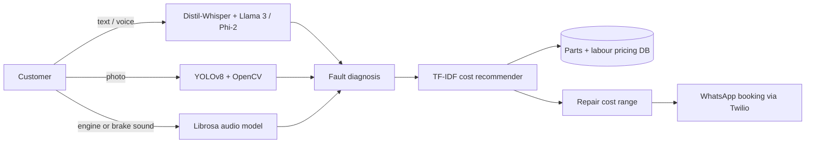

# 🚗 AUTO-MATE: AI Auto Workshop Assistant

Source code available on request.

An AI-powered vehicle diagnostic and car damage detection system that turns a car workshop into a smart digital assistant. Customers describe a problem in plain English (text or voice), upload a photo of visible damage, or record an engine or brake noise. The system works out the likely fault, gives a transparent repair cost range, and books a service appointment through WhatsApp.

Built as my final-year project for the BS Business Analytics program at International Islamic University Islamabad (IIUI), advised by Dr. Abdul Zahid.

<!-- Add a screenshot or demo GIF:  -->

## 🎯 The problem
- Car owners are unsure what repairs they need and worry about hidden costs
- Manual diagnosis by mechanics is slow and inconsistent
- Repair estimates aren't transparent, which hurts customer trust
- Booking a trusted mechanic is cumbersome

## ✨ Features
- 💬 **AI chatbot diagnostics:** LLMs interpret plain-English descriptions, typed or spoken, to detect likely faults
- 📸 **Photo inspection:** YOLO detects visible damage such as scratches and dents
- 🔊 **Sound analysis:** uploaded engine or brake recordings are analyzed to identify mechanical issues
- 💰 **Repair cost estimation:** a TF-IDF recommender matches the fault to a pricing dataset (PakWheels parts data plus labour fees) and returns a transparent cost range
- 📅 **Service booking:** appointments scheduled through WhatsApp

## 🏗️ How it works

## 📈 Results
- 70% less diagnosis time for common faults
- 35% higher user satisfaction from automated diagnosis and transparent estimates
- 25% more booking conversions
- 20% less workshop downtime

## 🛠️ Tech stack

| Area | Tools |
|------|-------|
| NLP and speech | Groq API, Llama 3, Phi-2, Distil-Whisper |
| Computer vision | YOLOv8 / YOLOv5, OpenCV |
| Audio | Librosa, TensorFlow / PyTorch |
| Backend and data | Python, FastAPI, Flask, SQLAlchemy, PostgreSQL / MySQL |
| Integrations | Twilio API (WhatsApp) |
