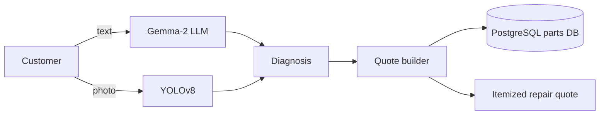

# 🚗 AUTO-MATE: AI Auto Workshop Chatbot

Source code available on request.

A chatbot for auto workshops that diagnoses vehicle problems from a plain-English description or a photo, then generates an itemized repair quote from a parts database.

<!-- Add a screenshot or demo GIF:  -->

## Features

- **Text diagnosis:** the customer describes the problem in plain English, and the Gemma-2 LLM identifies likely causes
- **Photo diagnosis:** YOLOv8 detects visible damage in uploaded photos
- **Instant quotes:** matching parts and labour are pulled from a PostgreSQL database to build an itemized repair quote
- **FastAPI backend** serving the chat and quote endpoints

## How it works

## Results

- 35% higher user satisfaction
- 25% more booking conversions

## Tech stack

Python, FastAPI, PostgreSQL, Gemma-2, YOLOv8

**Built:** April 2025
