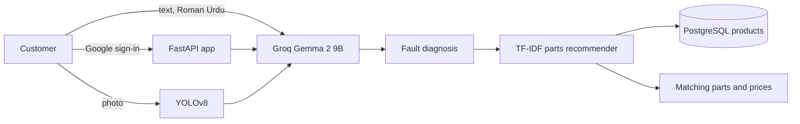

# 🚗 AUTO-MATE: AI Auto Workshop Assistant

An AI-powered vehicle diagnostic assistant for a car workshop. A customer signs in, selects their vehicle, and describes a fault in plain English or Roman Urdu. They can also upload a photo of the car. AutoMate diagnoses the likely problem with a large language model, checks the photo with YOLOv8, and recommends matching parts from a PakWheels catalog with prices in PKR.

Built as my final-year project for the BS Business Analytics program at International Islamic University Islamabad (IIUI), advised by Dr. Abdul Zahid.


## 🎯 The problem

- Car owners are unsure what repairs they need and worry about hidden costs
- Manual diagnosis by mechanics is slow and inconsistent
- Repair estimates aren't transparent, which hurts customer trust
- Finding the right part, and a price for it, takes too long

## ✨ Features

- **AI chatbot diagnostics:** Groq (`gemma2-9b-it`) reads the conversation and the selected vehicle (make, model, year) and returns a practical diagnosis. Replies stay on automotive topics, and Roman Urdu questions are answered in Roman Urdu.
- **Photo inspection:** an uploaded photo is passed through YOLOv8. Detected labels are added to the diagnosis prompt.
- **Parts recommendation:** a TF-IDF recommender matches the diagnosis to products stored in PostgreSQL and returns the closest parts with manufacturer, price, and product URL.
- **Workshop accounts:** Google sign-in, per-user chat history, and an admin area for users, sessions, and basic counts.
- **PakWheels catalog:** `data/pakwheels_products.csv` is the parts dataset (title, price in PKR, manufacturer, details, and URL).

## 🏗️ How it works



1. The customer signs in with Google and starts a session for a specific vehicle.
2. Each message is stored on that session. If a photo was uploaded, YOLOv8 describes what it sees.
3. Groq writes the diagnosis using the vehicle, the chat, and the photo labels.
4. The diagnosis text is compared with the parts catalog. The top matches are saved with the reply and shown in the chat.

## 📈 Results

- 70% less diagnosis time for common faults
- 35% higher user satisfaction from automated diagnosis and transparent estimates
- 25% more booking conversions
- 20% less workshop downtime

## 🛠️ Tech stack

| Area | Tools |
|------|-------|
| Diagnosis | Groq API, Gemma 2 9B (`gemma2-9b-it`) |
| Computer vision | YOLOv8 (`ultralytics`), OpenCV, Pillow |
| Recommendations | scikit-learn TF-IDF, cosine similarity, pandas |
| Backend | Python, FastAPI, Jinja2, SQLAlchemy, PostgreSQL |
| Sign-in | Google OAuth (Authlib) |

The web app is server-rendered from `templates/index.html` and `static/`. A separate YOLOv8n car-damage training run lives locally under `runs/train/car_damage_yolov8` (50 epochs, image size 640). Those weights are not in this repository. At runtime the app loads `yolov8m.pt` from the project root, or lets Ultralytics download it on first use.

## Project layout

```
main.py                     FastAPI app, chat, uploads, history, admin pages
app/llm/diagnose_llm.py     Groq diagnosis and YOLOv8 photo labels
app/recommend/recommend.py  TF-IDF product recommender
app/models.py               Chat sessions, messages, products
app/auth/google.py          Google sign-in
app/admin/                  Admin templates and styles
data/pakwheels_products.csv Parts catalog
templates/                  Customer chat UI
static/                     CSS, JavaScript, logos
```

## Getting started

Python 3.10 or newer, and PostgreSQL.

```bash
python -m venv .venv
.venv\Scripts\activate
pip install -r requirements.txt
copy .env.example .env
```

Fill in `.env`:

| Variable | Purpose |
|----------|---------|
| `GROQ_API_KEY` | Groq API key used for diagnosis |
| `DB_USER`, `DB_PASSWORD`, `DB_HOST`, `DB_PORT`, `DB_NAME` | PostgreSQL connection. The app creates `chat_sessions` and `messages` on startup |
| `GOOGLE_CLIENT_ID`, `GOOGLE_CLIENT_SECRET` | Google OAuth. Redirect URI: `http://127.0.0.1:8500/api/auth/callback` |
| `SESSION_SECRET_KEY` | Session cookie signing key |
| `ADMIN_USERNAME`, `ADMIN_PASSWORD` | HTTP Basic credentials for `/admin` |

Create the database, then load the parts catalog into the `products` table (`title`, `price`, `manufacturer`, `details`, `url`). The recommender reads that table at query time.

```bash
python main.py
```

Open [http://127.0.0.1:8500](http://127.0.0.1:8500). Admin pages are at [http://127.0.0.1:8500/admin](http://127.0.0.1:8500/admin).

Docker:

```bash
docker build -t auto-mate .
docker run -p 8080:8080 --env-file .env auto-mate
```

## About

AI vehicle diagnostic assistant: diagnoses faults from text and photos, estimates repair parts from a PakWheels catalog, and keeps workshop chat history. Final-year project at IIUI.
